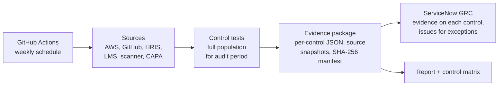

# Compliance Evidence Collector

Automated control testing and evidence collection for **SOC 2 Type II**, **ISO/IEC 27001:2022**, and **ISO 9001:2015**, with results pushed into **ServiceNow GRC**.

Controls are defined once in a unified control framework, mapped to every framework they satisfy, tested against the **full population** for the audit period, and packaged as tamper-evident evidence an auditor can re-perform.

> All data in `fixtures/` is synthetic. This is a standalone demonstration, not code from any employer.

## Why

A Type II report needs proof that controls operated across the whole observation period, not just on audit day. Collecting that by screenshot is slow, and the same evidence gets gathered again for each framework. This pipeline:

- runs on a schedule, so evidence exists for every week of the period
- tests each control once and reuses the evidence for SOC 2, ISO 27001, and ISO 9001
- records how each dataset was obtained, so the output holds up as information produced by the entity (IPE)
- opens a ServiceNow GRC issue for every control exception, so remediation is tracked where the GRC team works

## How it works



## Quick start

```bash
pip install -r requirements.txt
python -m evidence_collector                         # synthetic data, no credentials needed
python -m evidence_collector --servicenow dry-run    # also show the ServiceNow calls it would make
python -m evidence_collector --verify evidence/<run_id>/   # check the package hasn't been altered
pytest -q                                            # 29 tests
```

Output:

```
AC-01  MFA enforced for all console users                         pop=6   PASS
AC-02  Terminated users' access removed within 24 hours           pop=3   FAIL (1 exception(s))
AC-03  Quarterly user access review completed and signed off      pop=2   PASS
CM-01  Production branches protected with required review         pop=3   PASS
CM-02  Every production change independently approved before merg pop=18  FAIL (1 exception(s))
DP-01  Data stores encrypted at rest                              pop=5   FAIL (1 exception(s))
DP-02  No publicly accessible storage                             pop=5   PASS
LM-01  Audit logging enabled across all regions                   pop=2   PASS
VM-01  Critical and high vulnerabilities remediated within SLA    pop=5   FAIL (1 exception(s))
HR-01  Annual security awareness training completed               pop=5   PASS
QM-01  Nonconformities have root cause and corrective action clos pop=3   PASS

7/11 controls passed.
ServiceNow GRC (dry-run): evidence attached to 11 controls, 4 issues created, 0 already open
```

The synthetic data deliberately contains four realistic exceptions: a terminated employee whose account is still active, a hotfix merged without review, an unencrypted legacy bucket, and a critical vulnerability fixed after its 7-day SLA.

## The unified control framework

Defined in [`config/controls.yaml`](config/controls.yaml):

| Control | What is tested | SOC 2 | ISO 27001:2022 | ISO 9001 |
|---|---|---|---|---|
| AC-01 | MFA on every active console user | CC6.1 | A.5.17, A.8.5 | |
| AC-02 | Terminations deprovisioned within 24h | CC6.2, CC6.3 | A.5.18, A.6.5 | |
| AC-03 | Quarterly access review completed and signed off | CC6.2, CC6.3 | A.5.18 | |
| CM-01 | Branch protection with required review | CC8.1 | A.8.32, A.8.4 | 8.5.6 |
| CM-02 | Every merged change independently approved | CC8.1 | A.8.32 | 8.5.6 |
| DP-01 | Storage encrypted at rest | CC6.1, CC6.7 | A.8.24 | |
| DP-02 | No public storage | CC6.1, CC6.6 | A.8.3, A.8.20 | |
| LM-01 | Multi-region audit logging with validation | CC7.2 | A.8.15, A.8.16 | |
| VM-01 | Critical/high vulns fixed within SLA | CC7.1 | A.8.8 | |
| HR-01 | Annual security training | CC1.4, CC2.2 | A.6.3 | 7.2, 7.3 |
| QM-01 | Corrective actions have root cause, closed on time | CC4.2 | 10.2 | 10.2 |

Adding a control means adding an entry to the YAML and a test function in [`checks.py`](evidence_collector/checks.py) decorated with `@control_test("name")`.

## The evidence package

Each run writes `evidence/<run_id>/`:

| File | Purpose |
|---|---|
| `controls/<ID>.json` | Result, full population, every exception with a reason, framework mappings, and a reproducible auditor sample |
| `sources/<dataset>.json` | Snapshot of each dataset with the system and query used, so the test can be re-performed |
| `control_matrix.csv` | Unified control matrix with this run's results |
| `report.md` | Results, exceptions, and coverage by framework |
| `manifest.json` | SHA-256 of every file; `--verify` detects any later change |

Points an auditor will look for:

- **Completeness and accuracy.** Every dataset records its source system, query, and record count. Populations are listed in full.
- **Period scoping.** Event-based controls (terminations, merges, vulnerabilities, corrective actions) are filtered to the audit window. Configuration controls are point-in-time and run weekly.
- **Sampling.** Tests cover 100% of the population. A seeded random sample sized by control frequency is included for the auditor's own re-performance.
- **Integrity.** The manifest makes changes detectable. In production, packages go to write-once storage (for example S3 Object Lock).

## ServiceNow GRC

For each control, the evidence file is attached to its GRC control record (`sn_compliance_control`). For each failing control, a GRC issue (`sn_grc_issue`) is opened with the exceptions, mappings, and evidence hash, unless one is already open.

```bash
export SN_INSTANCE_URL=https://yourcompany.service-now.com
export SN_USER=... SN_PASSWORD=...
export SN_CONTROL_MAP='{"AC-01": "<sys_id>", "AC-02": "<sys_id>", ...}'
export SN_ISSUE_FIELDS='{"assignment_group": "<group sys_id>"}'   # optional
python -m evidence_collector --servicenow live
```

Control sys_ids can also go in `controls.yaml` (`servicenow_control_sys_id`). In live mode, unmapped controls are skipped and reported. Table names default to ServiceNow's standard GRC tables and can be overridden with `SN_CONTROL_TABLE` and `SN_ISSUE_TABLE`. Data models differ by instance and version, so confirm them with your ServiceNow admin and use a least-privilege integration account.

## Live sources

`--source live` pulls from real systems and falls back to fixtures for systems this demo doesn't connect to:

| Dataset | Live source |
|---|---|
| Identity users, MFA | AWS IAM (`list_users`, `get_login_profile`, `list_mfa_devices`) |
| Storage encryption, public access | AWS S3 (`get_bucket_encryption`, `get_public_access_block`) |
| Audit logging | AWS CloudTrail (`describe_trails`, `get_trail_status`) |
| Branch protection, merged PRs and approvals | GitHub REST API (`GITHUB_TOKEN`, `GITHUB_REPOS=org/repo,...`) |
| HRIS, LMS, scanner, CAPA register | Fixtures; replace with Workday, LMS, scanner, or GRC APIs |

Use a read-only AWS role. In GitHub Actions, the workflow assumes it through OIDC (`AWS_EVIDENCE_ROLE_ARN`), so no long-lived keys are stored.

## GitHub Actions

[`.github/workflows/evidence-collection.yml`](.github/workflows/evidence-collection.yml) runs the tests, then collects evidence weekly and on demand, verifies the package, publishes the report to the run summary, and uploads the package as an artifact. Collection only runs if tests pass. ServiceNow defaults to dry-run.

## Project layout

```
evidence_collector/
  sources.py      fixture and live (AWS, GitHub) data sources
  checks.py       one automated test per control
  evidence.py     packaging, sampling, manifest, report, verify
  servicenow.py   attach evidence to controls, open issues for exceptions
  collect.py      orchestration and CLI
config/controls.yaml
fixtures/          synthetic source data
tests/
```
# compliance-evidence-collector
